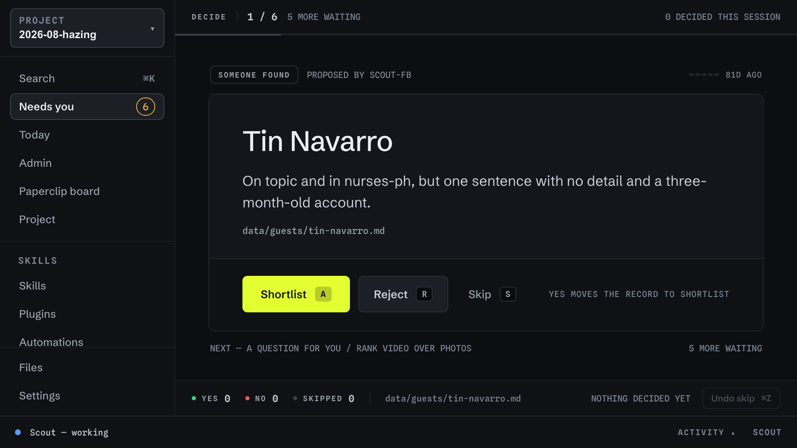
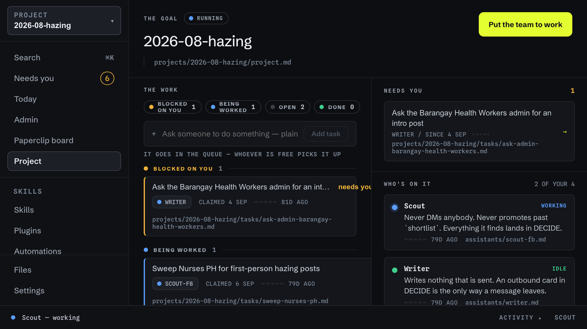
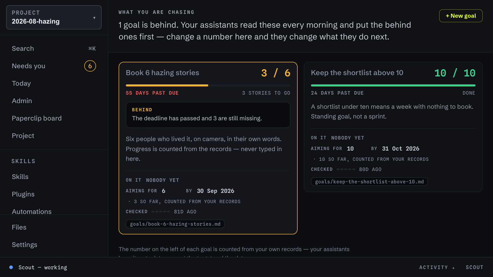
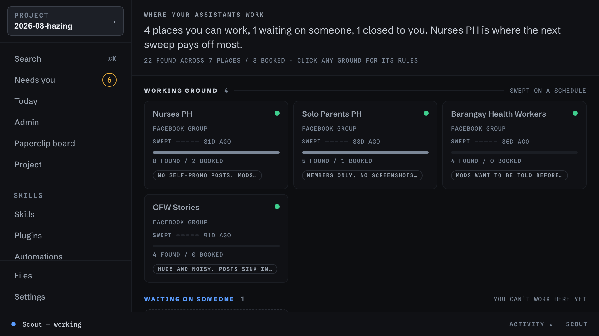
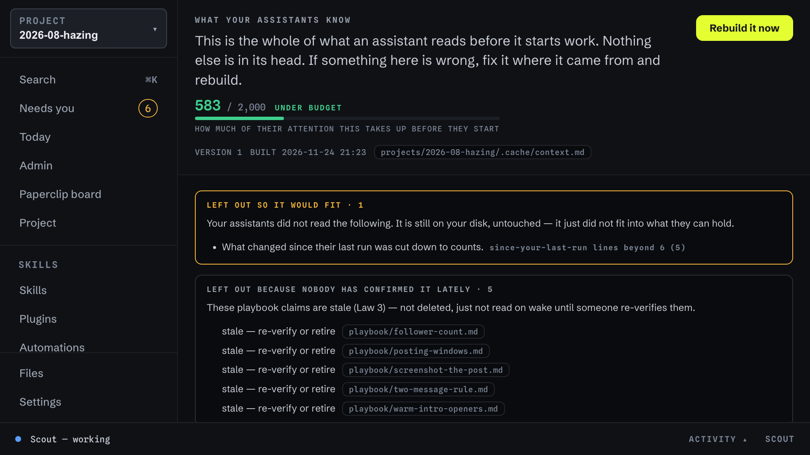
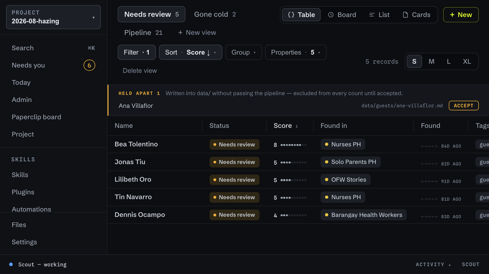
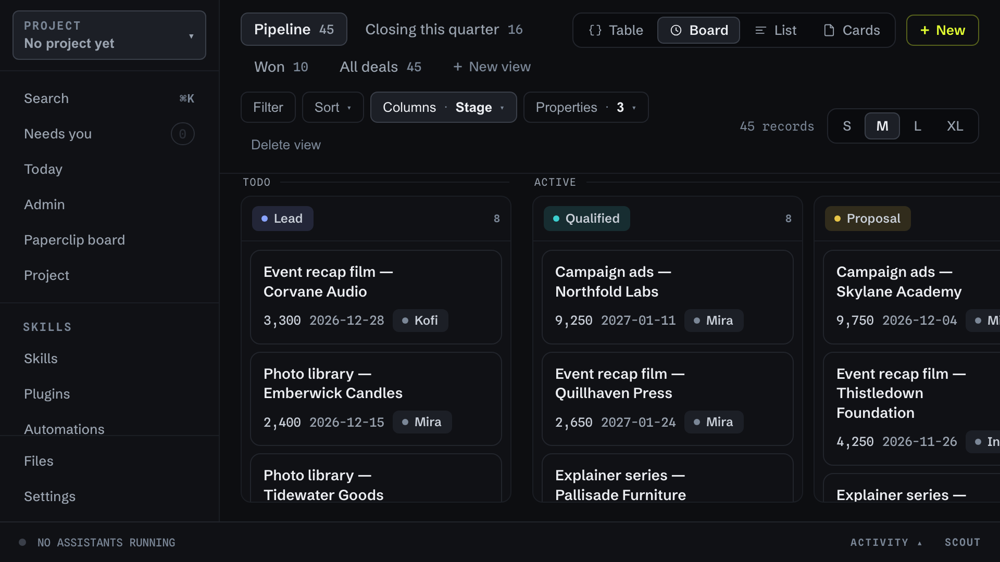
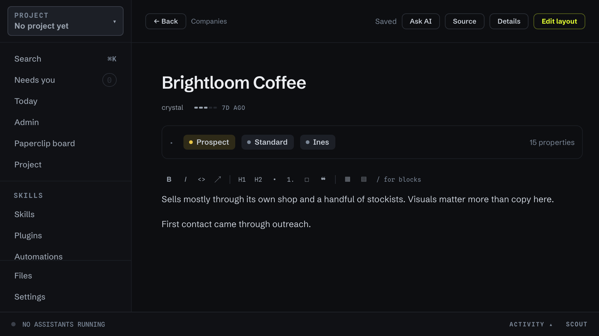
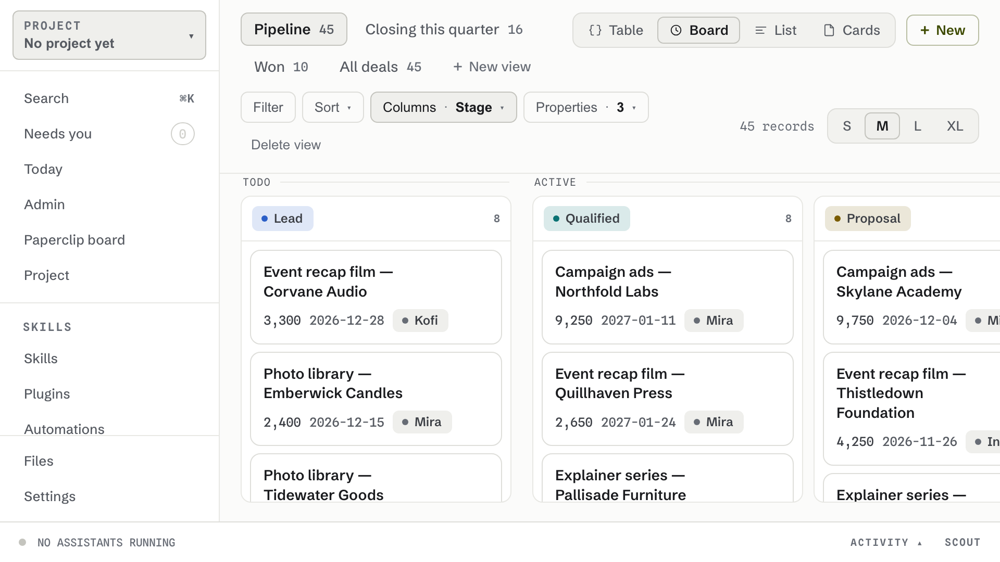

# Scout

A desktop app where you **orchestrate AI assistants that work all day for you**, and **curate the memory they run on**.
Local-first. Every record, memory and setting is a plain markdown file on your own disk — no database, no cloud account.
React + Express + Electron.



## What it does, in plain words

- **Decide.** Your assistants find things and propose them. You see one decision at a time — Shortlist, Reject or Skip — with the reason one click away. Nothing is sent or promoted until you say so.
- **Goals with real numbers.** A goal's progress is counted from your records, never typed in by an assistant. If a goal is behind, the assistants work on it first.
- **Memory you can read.** What an assistant knows is one short file you can open. Old facts fade on purpose and say how old they are.
- **Your own collections.** Make a table of anything — guests, deals, references. View it as a table, board, list or gallery, and drag things around.

| | |
|---|---|
|  |  |
|  |  |
|  |  |
|  |  |

The people and companies in these screenshots are made up; they come from the demo data in `workspace-demo/` and `workspace-crm/`.

## Free reference library + a skill for Claude

A library of **1,169 image references** (ads, YouTube thumbnails and more) with the prompt that rebuilds each look,
plus a skill that lets Claude search it and turn a reference into a ready prompt for your own product.
Prompts and names only — the pictures are not included.

- **Guide (start here, 2 minutes):** https://pub-6ff134bfbb7c44b29eab3e42c6df5c32.r2.dev/guide.html
- **Everything in one zip:** https://pub-6ff134bfbb7c44b29eab3e42c6df5c32.r2.dev/scout-reference-library.zip (5.8 MB)
- **Only the skill:** https://pub-6ff134bfbb7c44b29eab3e42c6df5c32.r2.dev/reference-library-skill.zip (11 KB). Its source is [`skills/reference-library/`](skills/reference-library/).

## Run it

You need [Node.js](https://nodejs.org) 22 or newer.

```bash
npm ci
npm run demo     # copies the demo workspace into workspace/ (never overwrites an existing one)
npm start        # build and serve the app on http://127.0.0.1:5177
```

`workspace/` is yours from then on and is gitignored. `npm test` runs the suite and `npm run demonstrate` runs the ten acceptance gates from `GOAL.md` against a throwaway copy.
On an exFAT drive, macOS leaves `._*` files behind that make `npm test` fail — see `HANDOVER.md` §3 for the one-line cleanup.

## For contributors

Read in this order:

1. **`GOAL.md`** — the acceptance contract and the ten gates. It wins every conflict.
2. **`CLAUDE.md`** — the build contract: source-of-truth table, hard rules, ports.
3. **`docs/01_CANON.md`** — the laws, and the failure each one prevents.
4. Then the doc for whatever you are building: `02_DATA_MODEL` · `03_MEMORY` · `04_AGENT_CONTRACT` · `05_UI_SPEC` · `06_REUSE` · `07_BUILD_ORDER`.
5. **`tasks/`** — one file per task, in order.

### The shape, in five lines

- Every record, memory and schema is a `.md` file. The index is derived and disposable.
- Every surface opens at a **decision**; reasoning is one click, evidence is two.
- Memory **decays on purpose** and shows its age.
- Agents propose; humans dispose. The gate lives in the pipeline, never in a prompt.
- The agent wakes, reads **one file under 2,000 tokens**, and already knows everything it needs.

### Where the code comes from

A fork of FrameForge with the film domain removed, plus specific patterns from Tesseract MD, Hermes Fleet and TencentDB-Agent-Memory. `docs/06_REUSE.md` is the file-by-file map. FrameForge's own agent docs are preserved as `docs/FRAMEFORGE_CLAUDE.md`, `docs/FRAMEFORGE_README.md` and `docs/FRAMEFORGE_ISSUES.md`.

### Design

Tokens, density and the accent rules are inherited from FrameForge's `docs/DESIGN.md`. The token and component audit is in `design/EXTRACT.md`; `docs/05_UI_SPEC.md` §2 lists what the current design is still missing.
